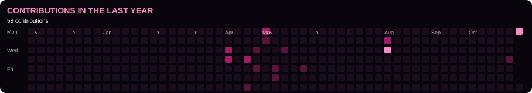

<h3>GENERATIVE AI ENGINEER | AGENTIC AI | RAG</h3>

Building intelligent applications with Python, LLMs, AWS and multi-agent systems.

---

## GITHUB ACTIVITY

  

  

---

<h2 align="center">ABOUT ME</h2>

I'm a Generative AI Engineer interested in building practical AI applications, agentic workflows and secure RAG systems. I work with Python, AWS, LLM frameworks and enterprise data platforms to turn AI concepts into working applications.

---

<h2 align="center">EXPERIENCE</h2>

### AI Engineer — Ecom cent Technologies Private Limited

`CLIENT: ALTIMETRIK` · `NOV 2024 – PRESENT` · `BENGALURU, INDIA`

- Developing GenAI applications for financial intelligence and enterprise knowledge retrieval.
- Building RAG workflows and LLM-powered document analysis solutions.
- Working with Python, LangChain, AWS Bedrock and Snowflake.

---

<h2 align="center">FEATURED PROJECTS</h2>

### 01. Multi-Agent Coffee Shop Automation

`AWS BEDROCK` · `STRANDS SDK` · `MCP` · `OPENSEARCH` · `DYNAMODB`

Multi-agent architecture with a supervisor coordinating specialist agents for orders, menus, stores, offers and payments.

### 02. RBAC-RAG Secure Document Intelligence

`PYTHON` · `FASTAPI` · `REACT` · `CHROMADB` · `OLLAMA`

Secure document retrieval with role-based access, JWT authentication and metadata filtering.

### 03. ECS Fargate CI/CD

`DOCKER` · `AWS ECS` · `ECR` · `CODEPIPELINE`

Automated container deployment using CI/CD and blue-green deployment.

### 04. Azure AI Invoice Processing

`AZURE FUNCTIONS` · `EVENT GRID` · `DOCUMENT INTELLIGENCE` · `AZURE SQL`

Event-driven invoice extraction and processing with managed identity and confidence-based review.

---

<h2 align="center">BUILDS & EXPERIMENTS</h2>

| PROJECT | FOCUS | GITHUB |
|---|---|---|
| **Bedrock Guardrails Agent** | Prompt injection, PII filtering, responsible AI | [OPEN](https://github.com/VinuthnaReddy07?tab=repositories) |
| **SageMaker MLOps — Customer Churn** | Training, evaluation, Model Registry | [OPEN](https://github.com/VinuthnaReddy07?tab=repositories) |
| **SageMaker Data Drift Monitoring** | CloudWatch, SNS, automated retraining | [OPEN](https://github.com/VinuthnaReddy07?tab=repositories) |
| **Data Wrangler & EMR** | Data preparation, feature engineering, Spark | [OPEN](https://github.com/VinuthnaReddy07?tab=repositories) |
| **SageMaker XGBoost** | Script-mode training, hyperparameter tuning | [OPEN](https://github.com/VinuthnaReddy07?tab=repositories) |

---

<h2 align="center">TECH STACK</h2>

**PROGRAMMING**

**CLOUD & DEVOPS**

**DEVELOPMENT & DATABASES**

**GENERATIVE AI & DATA**

`LANGCHAIN` · `STRANDS SDK` · `MCP` · `AMAZON BEDROCK`

`SAGEMAKER` · `CHROMADB` · `OPENSEARCH` · `DYNAMODB` · `SNOWFLAKE`

**CORE AREAS**

`AGENTIC AI` · `RAG` · `LLM APPLICATIONS` · `PROMPT ENGINEERING` · `RESPONSIBLE AI`

---

<h2 align="center">CERTIFICATIONS & LEARNING</h2>

- Python Certification — Kaggle
- AWS Educate — ML Foundations
- HackerRank SQL — Basic & Intermediate
- AWS Machine Learning Engineer Associate — Preparing

---

<h2 align="center">EDUCATION</h2>

**BACHELOR'S IN COMPUTER SCIENCE**

Vishwa Vishwani Institute of Systems and Management

Affiliated to Osmania University · 2021–2025

---

**BUILD · EXPERIMENT · LEARN · REPEAT**

